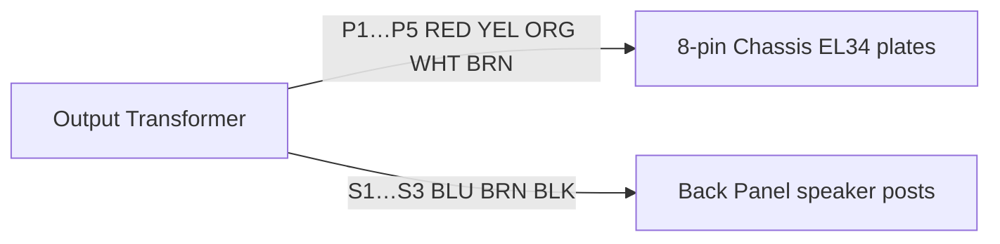

# Output Transformers (OT)

Two identical units — one per channel. Primaries → **8-pin Chassis**; secondaries → rear-panel speaker posts. See also [`TRANSFORMERS.md`](TRANSFORMERS.md) (index), [`PT.md`](PT.md).

Factory type (secondary reference): **LM-9914U** — factory **T1** in [`Jolida-JD202A-int-sch.pdf`](Jolida-JD202A-int-sch.pdf) ([`_sch-page-1.png`](_sch-page-1.png)).

| Unit   | Photos                                                             | Notes                                                           |
| ------ | ------------------------------------------------------------------ | --------------------------------------------------------------- |
| Unit 1 | [`ot-1.png`](../photos/ot-1.png), [`ot-2.png`](../photos/ot-2.png) | Same part — assign **LFT** or **RT** by stub tags at reassembly |
| Unit 2 | [`ot-3.png`](../photos/ot-3.png), [`ot-4.png`](../photos/ot-4.png) | Same part — other channel                                       |

**Both OT units are identical.** Channel is **not** fixed to unit 1 vs unit 2 — it is fixed by **disassembly tags** on the speaker stubs ([`hand_schematic.png`](../photos/hand_schematic.png)).

---

## Output Transformer Summary

Each OT has **five primary leads** (**RED, YEL, ORG, WHT, BRN** → **8-pin Chassis**) and **three secondary leads** (**BLU, BRN, BLK** → rear-panel speaker posts). One **T1** / **LM-9914U** per channel (**V3/V4** left, **V7/V8** right).

### Primary — tube side

Five taps on **one primary winding** in an **ultra-linear push-pull** pair (EL34s **V3 + V4** per channel):

| PDF connection | What it is        | Hooked to                           |
| -------------- | ----------------- | ----------------------------------- |
| Upper end      | **Plate**         | EL34 **pin 3** (one tube)           |
| Next           | **UL tap**        | EL34 **pin 4** (screen, same tube)  |
| Center         | **B+ center tap** | **+B** rail (~**425 V** DC)         |
| Next           | **UL tap**        | EL34 **pin 4** (screen, other tube) |
| Lower end      | **Plate**         | EL34 **pin 3** (other tube)         |

The phase inverter (**12AT7**) drives the two EL34 **grids** out of phase. One tube pulls current up through its half of the primary; the other pulls down. The **AC** component in that push-pull current is what the core couples to the speaker winding. The **UL taps** feed the screen grids from partway out on the primary — classic UL compromise between pentode power and triode-like distortion.

The five coil colors are those five roles. The PDF does not show which color is which — that is still **T-2** at reassembly.

### Secondary — speaker side

| PDF label | Function   | Hooked to                 |
| --------- | ---------- | ------------------------- |
| **8 Ω**   | 8 Ω tap    | Rear **8 Ω** post         |
| **4 Ω**   | 4 Ω tap    | Rear **4 Ω** post         |
| **0**     | **Common** | Rear **G** post → **GND** |

One secondary winding, three taps. Strap the speaker between **0 (G)** and **4 Ω** or **8 Ω**. At the coil:

| Coil color | Tap       |
| ---------- | --------- |
| **BLK**    | **0** (G) |
| **BLU**    | **4 Ω**   |
| **BRN**    | **8 Ω**   |

*(Secondary **BRN** — not the same wire as primary **BRN**.)* Panel-end colors may differ after harness splices; coil colors are authoritative.

---

## How to read the tables

| Column             | Meaning                                                                              |
| ------------------ | ------------------------------------------------------------------------------------ |
| **Signal**         | Electrical function (best estimate until meter confirms)                             |
| **At transformer** | Insulation color on the **short lead exiting the coil**                              |
| **After splice**   | Color on the **extension/harness** (yellow or green heat-shrink joints)              |
| **Tag**            | Disassembly tag from [`wire-tags.md`](wire-tags.md)                                  |
| **Goes to**        | Destination assembly                                                                 |
| **Conf.**          | **High** = label or tag match · **Med** = photo + harness · **Low** = guess — verify |

Splices are common on this unit. Always trust **continuity**, not color alone.

---

## Role in the amp

Each OT has:

- **Primary side** → **8-pin Chassis** (plates / ultralinear — hardwired, not C4)
- **Secondary side** → **Back Panel** speaker binding posts (**0**, **4 Ω**, **8 Ω**)

### Channel assignment (from hand schematic)

[`hand_schematic.png`](../photos/hand_schematic.png) labels the rear-panel strip **LFT** vs **RT** and ties each speaker stub to a channel:

| Channel | OT secondary tags      | Panel posts                     |
| ------- | ---------------------- | ------------------------------- |
| **LFT** | **1**, **15**, **19**  | **G**, **4 Ω**, **8 Ω** (left)  |
| **RT**  | **11**, **17**, **13** | **G**, **4 Ω**, **8 Ω** (right) |

At reassembly: the OT whose stubs carry **1 / 15 / 19** → **LFT**; the OT whose stubs carry **11 / 17 / 13** → **RT**. Parts are interchangeable electrically; matching the original tag grouping is for consistency.

| Speaker post       | Tag | Color at panel end (after splices) |
| ------------------ | --- | ---------------------------------- |
| **LFT G** (common) | 1   | BLK                                |
| **LFT 4 Ω**        | 15  | BLK (was BLU at OT)                |
| **LFT 8 Ω**        | 19  | BLU (was BRN / PRP)                |
| **RT G** (common)  | 11  | BRN (was BLK)                      |
| **RT 4 Ω**         | 17  | BLU (was YEL)                      |
| **RT 8 Ω**         | 13  | RED (was BRN / PRP)                |

---

## Bench meter checklist (OT only, no chassis)

You **already know** which side is which, and secondary tap colors at the coil:

- **5-lead side** (**RED, YEL, ORG, WHT, BRN**) = **primary** → 8-pin / EL34
- **3-lead side:** **BLK** = **G**, **BLU** = **4 Ω**, **BRN** = **8 Ω** → speaker posts

Optional meter work here is **sanity-check only** (confirm the two winding groups). The open mapping is **T-2** only: which primary color is **plate / UL / B+ CT**.

**Setup:** OT sitting alone. **No** tubes, boards, or harness stubs connected. DMM on **Ω** (start at **200 Ω**; use **2 kΩ** if the display reads **OL**).

### Step 1 — Confirm the two winding groups (optional)

| Test                                       | Expect                                                 |
| ------------------------------------------ | ------------------------------------------------------ |
| Any **two** of the **five** primary colors | **Continuity** (low Ω — tens to hundreds on primary)   |
| Any **two** of **BLU / BRN / BLK**         | **Continuity** (low Ω — often **~1–5 Ω** on secondary) |
| One primary color ↔ one secondary color    | **OL** (no connection — separate windings)             |

If that pattern fails, stop and re-check which wires belong to this OT.

### Step 2 — Primary: find center tap and ends (closes **T-2**)

On **RED, YEL, ORG, WHT, BRN** only, measure each pair (ten readings). Sort from **highest Ω to lowest**.

| Pattern                     | What it usually means                       |
| --------------------------- | ------------------------------------------- |
| **Highest** pair            | **Plate ↔ plate** (far ends of the winding) |
| **~Half** of that value     | **Center tap (B+) ↔ plate**                 |
| **Lower** than center↔plate | **UL tap ↔ center** or **UL ↔ plate**       |

The lead that reads **~half** of the max plate-to-plate value against **both** far ends is the **B+ center tap**. The two far ends are **plates**; the two in between are **UL screen taps** (factory PDF order — see [Factory schematic](#factory-schematic--t1-lm-9914u)).

Final proof is at **reassembly**: connect one 8-pin socket, power up gently, and confirm **+B** lands on the center-tap wire.

Record results in the [Bench worksheet](#bench-worksheet-disassembled) below.

---

## Physical lead inventory (bench-confirmed)

Each OT has **eight leads total** — **five on one side**, **three on the other**. **No duplicate colors on one side** (only one **RED**). **BRN appears on both sides** — two **different** wires.

| Side          | Colors (at coil)            | Count | Destination                                           | Photos                                                             |
| ------------- | --------------------------- | ----- | ----------------------------------------------------- | ------------------------------------------------------------------ |
| **Primary**   | **RED, YEL, ORG, WHT, BRN** | 5     | **8-pin Chassis** / EL34 push-pull                    | [`ot-1.png`](../photos/ot-1.png), [`ot-4.png`](../photos/ot-4.png) |
| **Secondary** | **BLU, BRN, BLK**           | 3     | **BLU** → **4 Ω**, **BRN** → **8 Ω**, **BLK** → **G** | [`ot-2.png`](../photos/ot-2.png), [`ot-3.png`](../photos/ot-3.png) |

Both OT units match this inventory ([`ot-1`…`ot-4`](../photos/)). Primary-side extensions often use **yellow** “WTT TUBE 125°C” heat-shrink; secondary leads may use the same sleeve at the body.

The same **5 + 3** pinout appears on factory **T1** (**LM-9914U**) in [`Jolida-JD202A-int-sch.pdf`](Jolida-JD202A-int-sch.pdf) — see [`_sch-page-1.png`](_sch-page-1.png). **Primary** color → role is still **T-2**; **secondary** colors are fixed at the coil (**BLK** / **BLU** / **BRN**).

---

## Factory schematic — T1 (LM-9914U)

Source: [`Jolida-JD202A-int-sch.pdf`](Jolida-JD202A-int-sch.pdf) (JD202A.s01, 2002-04-19). One **T1** per channel (**V3/V4** left, **V7/V8** right). Part marking: **LM-9914U**.

### Primary — five connections (tube / 8-pin side)

Ultra-linear **push-pull**: two **EL34** plates, two **UL screen taps**, one **B+ center tap** on **+B (+425 V)**.

| PDF order (schematic) | Electrical function | Connects to                              |
| --------------------- | ------------------- | ---------------------------------------- |
| 1 — upper end         | **Plate**           | EL34 **pin 3** (one tube, e.g. **V3**)   |
| 2                     | **UL tap**          | EL34 **pin 4** (screen, same tube)       |
| 3 — center            | **Center tap (B+)** | **+B** rail (~425 V DC)                  |
| 4                     | **UL tap**          | EL34 **pin 4** (other tube, e.g. **V4**) |
| 5 — lower end         | **Plate**           | EL34 **pin 3** (other tube)              |

Bench colors (**RED, YEL, ORG, WHT, BRN**) map to these five roles — **T-2** (Ω groups + one 8-pin socket at a time). PDF does not show harness colors.

### Secondary — three connections (speaker side)

| PDF label | Function | Connects to                     |
| --------- | -------- | ------------------------------- |
| **8 Ω**   | 8 Ω tap  | Rear-panel **8 Ω** binding post |
| **4 Ω**   | 4 Ω tap  | Rear-panel **4 Ω** binding post |
| **0**     | Common   | Rear-panel **G** post → **GND** |

Bench colors at the coil: **BLK** → **0**, **BLU** → **4 Ω**, **BRN** → **8 Ω**. Panel-end colors often differ after splices.

```text
        V3 plate ────────┐
        V3 screen (UL) ──┤
              +B CT ─────┼── T1 LM-9914U ──┬── 8 Ω  → panel
        V4 screen (UL) ──┤                 ├── 4 Ω  → panel
        V4 plate ────────┘                 └── 0    → GND / panel G
```

## Unit 1 vs unit 2 — photo comparison

| View               | OT unit 1                        | OT unit 2                        | Match?                                                     |
| ------------------ | -------------------------------- | -------------------------------- | ---------------------------------------------------------- |
| Secondary (3-lead) | [`ot-2.png`](../photos/ot-2.png) | [`ot-3.png`](../photos/ot-3.png) | **Same** — **BLU, BRN, BLK**                               |
| Both sides         | [`ot-1.png`](../photos/ot-1.png) | [`ot-4.png`](../photos/ot-4.png) | **Same** — **RED, YEL, ORG, WHT, BRN** + **BLU, BRN, BLK** |

**Conclusion:** Both units are the **same OT part**; only L/R channel assignment differs.

---

## Primary side — five leads (8-pin / EL34)

**RED, YEL, ORG, WHT, BRN** → **8-pin Chassis**. Matches factory **T1** primary count ([`Jolida-JD202A-int-sch.pdf`](Jolida-JD202A-int-sch.pdf)): two **plates**, two **UL screen taps**, one **+B center tap** — see table above.

| #   | At transformer | Factory role (PDF) | Goes to               | Conf. |
| --- | -------------- | ------------------ | --------------------- | ----- |
| P?  | **RED**        | Plate / UL / B+ CT | EL34 socket or **+B** | Low   |
| P?  | **YEL**        | Plate / UL / B+ CT | EL34 socket or **+B** | Low   |
| P?  | **ORG**        | Plate / UL / B+ CT | EL34 socket or **+B** | Low   |
| P?  | **WHT**        | Plate / UL / B+ CT | EL34 socket or **+B** | Low   |
| P?  | **BRN**        | Plate / UL / B+ CT | EL34 socket or **+B** | Low   |

**Not** the same **BRN** as on the secondary side. Assign **P1–P5** to PDF roles at bench (**T-2**).

---

## Secondary side — three leads (speaker posts)

**BLU, BRN, BLK** → rear-panel binding posts. Matches factory **T1** secondary: **8 Ω**, **4 Ω**, **0** (common → **GND**) — see table above.

| #   | At transformer | Factory role (PDF) | Goes to                 | Conf. |
| --- | -------------- | ------------------ | ----------------------- | ----- |
| S1  | **BLK**        | **0** (common)     | Back panel **G** post   | High  |
| S2  | **BLU**        | **4 Ω** tap        | Back panel **4 Ω** post | High  |
| S3  | **BRN**        | **8 Ω** tap        | Back panel **8 Ω** post | High  |

Panel-end colors often **differ** after harness splices — see speaker table above and [`hand-schematic-notes.md`](hand-schematic-notes.md).

**Not** the same **BRN** as on the primary side.

### Diagram (one channel — duplicate per OT unit)



---

## Bench worksheet (disassembled)

Do **unit 1** and **unit 2** on separate sheets; compare — groups should match if parts are identical.

### Winding groups

| Lead ID  | Partner lead(s)   | R (Ω) | Primary or secondary? | Tag on stub (if any)        |
| -------- | ----------------- | ----- | --------------------- | --------------------------- |
| P1 (RED) |                   |       | Primary (5-lead side) |                             |
| P2 (YEL) |                   |       |                       |                             |
| P3 (ORG) |                   |       |                       |                             |
| P4 (WHT) |                   |       |                       |                             |
| P5 (BRN) |                   |       |                       |                             |
| S1 (BLK) | S2 (BLU) S3 (BRN) |       | Secondary (3-lead)    | 1 / 15 / 19 or 11 / 17 / 13 |
| S2 (BLU) | S1, S3            |       |                       |                             |
| S3 (BRN) | S1, S2            |       |                       |                             |

### Channel assignment (at reassembly)

| Decision                    | Record here                                                 |
| --------------------------- | ----------------------------------------------------------- |
| OT with tags **1, 15, 19**  | **LFT**                                                     |
| OT with tags **11, 17, 13** | **RT**                                                      |
| Swap units?                 | **No** — reassemble to match hand schematic for consistency |

### Tagged stub inventory

| Tag | Stub color | OT unit | Lead ID | Was going to (from hand schematic) |
| --- | ---------- | ------- | ------- | ---------------------------------- |
| 1   |            | LFT     | S1 BLK  | LFT G                              |
| 15  |            | LFT     | S2 BLU  | LFT 4 Ω                            |
| 19  |            | LFT     | S3 BRN  | LFT 8 Ω                            |
| 11  |            | RT      | S1 BLK  | RT G                               |
| 17  |            | RT      | S2 BLU  | RT 4 Ω                             |
| 13  |            | RT      | S3 BRN  | RT 8 Ω                             |

---

## Open items

| ID      | Question                               | Status / action                                                                                                              |
| ------- | -------------------------------------- | ---------------------------------------------------------------------------------------------------------------------------- |
| **T-1** | Which OT is **Left** vs **Right**?     | **Closed** — **LFT** stubs **1, 15, 19**; **RT** stubs **11, 17, 13** ([`hand_schematic.png`](../photos/hand_schematic.png)) |
| **T-2** | Which color is **plate / UL / B+ CT**? | Topology fixed by PDF (**5** roles); buzz **RED, YEL, ORG, WHT, BRN** to 8-pin / **+B** at reassembly                        |

---

## Related

- [`wire-tags.md`](wire-tags.md) — tag index (speaker paths)
- [`hand-schematic-notes.md`](hand-schematic-notes.md) — harness map
- [`CONNECTORS.md`](CONNECTORS.md) — OT primaries hardwired on 8-pin chassis; **not** on C1
- [`Jolida-JD202A-int-sch.pdf`](Jolida-JD202A-int-sch.pdf) — factory **T1** / **LM-9914U** pinout ([`_sch-page-1.png`](_sch-page-1.png))
- [`PT.md`](PT.md) — power transformer (separate unit)

---

## Changelog

| Date       | Change                                                                                             |
| ---------- | -------------------------------------------------------------------------------------------------- |
| 2026-07-06 | Split from `TRANSFORMERS.md`; photo inventory from ot-1…ot-4                                       |
| 2026-07-06 | Correct lead count: **5 + 3** per unit (not 5 + 7); one **RED** only                               |
| 2026-07-06 | Factory **T1** / **LM-9914U** pinout from [`Jolida-JD202A-int-sch.pdf`](Jolida-JD202A-int-sch.pdf) |
| 2026-07-06 | **Bench meter checklist** — step-by-step secondary + primary measurements                          |
| 2026-07-06 | Secondary taps fixed at coil: **BLK** = G, **BLU** = 4 Ω, **BRN** = 8 Ω; **T-3** removed           |
| 2026-07-06 | **Output Transformer Summary** at top — primary UL push-pull + secondary taps                      |
| 2026-07-06 | **T-1** closed — **LFT** tags **1/15/19**, **RT** tags **11/17/13** per hand schematic             |
