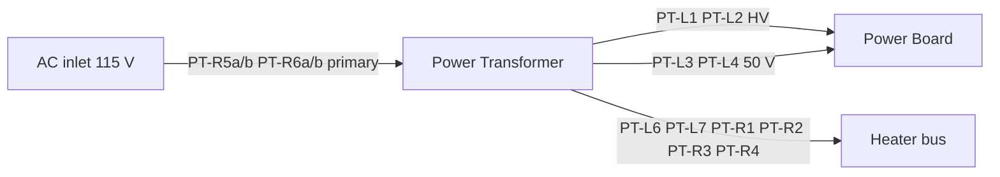

# Power Transformer (PT)

Center unit — mains in, secondaries to Power Board, heaters, and preamp ground. See also [`TRANSFORMERS.md`](TRANSFORMERS.md) (index), [`OT.md`](OT.md).

Factory type (secondary reference): **LM-9908P-A** class — [`schematic-comparison.md`](schematic-comparison.md).

Photos: [`pt.png`](../photos/pt.png), [`transformers.png`](../photos/transformers.png).

---

## Summary

- **115 V in:** strap **RED1+RED2** → line, **ORG1+ORG2** → neutral
- **RED/BLK:** ~300 V HV secondary → Power Board bridge → DC rails:
  - **+B** (~425 V) — main plate supply (PCB silk; PDF **+B**)
  - **+B1** (~370 V) — screens / drivers
  - **+B2** (~220 V) — preamp
- **BLU/BLU:** ~50 V aux secondary
- **⊥ BLK:** ground tie
- **YEL**, **BRN**, and **WHT** pairs: **6.3 V AC** heaters for the tube filaments

---

## How to read the tables

| Column             | Meaning                                                                              |
| ------------------ | ------------------------------------------------------------------------------------ |
| **Signal**         | Electrical function (best estimate until meter confirms)                             |
| **At transformer** | Insulation color on the **short lead exiting the coil**                              |
| **After splice**   | Color on the **extension/harness** (yellow or green heat-shrink joints)              |
| **Tag**            | Disassembly tag from [`wire-tags.md`](wire-tags.md)                                  |
| **Goes to**        | Destination assembly                                                                 |
| **Conf.**          | **High** = label or tag match · **Med** = photo + harness · **Low** = guess — verify |

Splices are common on this unit. Always trust **continuity**, not color alone.

---

## Coil label

Label on coil ([`pt.png`](../photos/pt.png)):

```text
0  300V  240V     300 mA
   50V   0        100 mA
   6.3V  0        3 A

   6.3V  6.3V     3 A / 3 A
   115V
   115V
```

Matches [`transformers.png`](../photos/transformers.png): **0 280V 300V**, dual **6.3 V @ 4 A**, **50 V**, dual **115 V** primary.

---

## Left side of coil (top → bottom, bench 2026-07-06)

Physical order at the coil. **Twisted pair** = two leads exit together; tags are on the **cut harness stubs**.

| #     | Coil label (as read)          | Signal                             | Wires (at coil)   | Tag(s)     | Notes                                                                                                                                                              | Conf. |
| ----- | ----------------------------- | ---------------------------------- | ----------------- | ---------- | ------------------------------------------------------------------------------------------------------------------------------------------------------------------ | ----- |
| PT-L1 | **0 / 300 V / 240 V**         | **HV AC** — 300 V ↔ 0 V            | **RED** + **BLK** | **21** RED | Twisted pair to Power Board **AC IN** → **VD3–VD6**                                                                                                                | High  |
| PT-L2 | *(same HV group)*             | **HV return (0 V)**                | **BLK**           | **11** BLK | Same twisted pair as PT-L1; **240 V tap capped** (unused)                                                                                                          | High  |
| PT-L3 | **50 V**                      | **50 V aux** (one end)             | **BLU**           | **17**     | Twisted pair; both legs **blue** at coil                                                                                                                           | High  |
| PT-L4 | **50 V**                      | **50 V aux** (other end)           | **BLU**           | **19**     | Same twisted pair as PT-L3 → Power Board aux / **−B** path                                                                                                         | High  |
| PT-L5 | **0** *(⊥ / upside-down “T”)* | **Ground reference** (label **0**) | **BLK**           | **9**      | **Preamp board GND** — large copper pour bottom-left between white ceramics ([`preamp board top.png`](../photos/preamp%20board%20top.png)); OL to **17/19** @ coil | High  |
| PT-L6 | **6.3 V**                     | **Heater 6.3 V**                   | **WHT**           | **5**      | Twisted pair (both white); was drawn as preamp **tag 5** on hand sch.                                                                                              | High  |
| PT-L7 | **6.3 V**                     | **Heater 6.3 V return**            | **WHT**           | **5**      | Same pair as PT-L6                                                                                                                                                 | High  |

**50 V:** **BLU/BLU** (**17**, **19**) = one winding, **15 Ω** DCR. **Tag 9** (**PT-L5**) is the label **0** lead — **not** in the BLU pair electrically; terminates on **preamp board ground** (not bias trim pots, not Power Board AC IN).

**HV:** **21 ↔ 11** = **25 Ω** DCR. Use **300 V** (red) and **0** (black). **240 V** is capped (unused).

---

## DCR — bench measurements (2026-07-06)

Meter on **coil leads only**; **200 Ω** range unless noted. **OL** = over-range on that scale (may hide high Ω — retry on **2 kΩ** if needed).

| Measure (coil leads) | DCR   | Winding / note                                                |
| -------------------- | ----- | ------------------------------------------------------------- |
| **21 RED ↔ 11 BLK**  | 25 Ω  | **HV** 300 V ↔ 0 V — confirms **PT-L1/L2**                    |
| **17 BLU ↔ 19 BLU**  | 15 Ω  | **50 V aux** — confirms **PT-L3/L4**                          |
| **17 BLU ↔ 9 BLK**   | OL    | **PT-L5** not in BLU pair (on 200 Ω scale)                    |
| **19 BLU ↔ 9 BLK**   | OL    | Same                                                          |
| **WHT ↔ WHT**        | 2.5 Ω | **6.3 V** heater — **PT-L6/L7**                               |
| **BRN ↔ BRN**        | 2.2 Ω | **6.3 V** heater — **PT-R1/R2**                               |
| **YEL ↔ YEL**        | 2.2 Ω | **6.3 V** heater — **PT-R3/R4**                               |
| **RED ↔ RED**        | OL    | Two **separate** 115 V primaries — not one continuous winding |
| **ORG ↔ ORG**        | OL    | Same — parallel primaries, not series                         |
| **RED1 ↔ ORG1**      | ~5 Ω  | Primary half **A** (meter read **0.005** — see note below)    |
| **RED2 ↔ ORG2**      | ~5 Ω  | Primary half **B**                                            |
| **RED1 ↔ ORG2**      | OL    | Halves isolated — **115 V parallel** wiring                   |
| **RED2 ↔ ORG1**      | OL    | Same                                                          |

**Primary note:** If the meter displayed **0.005** on a **kΩ** range, that is **5 Ω** — plausible for one 115 V half. If it truly read **0.005 Ω**, that is lead-resistance territory; the **pairing pattern** below still holds.

**115 V operation:** Tie **RED1 + RED2** → hot (merged harness **tag 21**); tie **ORG1 + ORG2** → neutral (merged **tag 23**). Do **not** tie RED to ORG across halves.

**Heaters:** three **isolated** ~2 Ω pairs — no **1×2 / 5×2 / 10×2** tags at coil.

**Tags 17 / 19 / 11 / 21 on the PT** — hand schematic also placed these numbers on **OT speaker** or **preamp/power-board** paths. Treat **continuity from this coil lead** as authoritative; reassign OT/panel rows in [`wire-tags.md`](wire-tags.md) when stubs are buzzed.

### Identify windings (PT only, no chassis)

| Winding type             | Typical DCR / pattern                            |
| ------------------------ | ------------------------------------------------ |
| **Heater 6.3 V**         | Very low Ω (often **~0.5–2 Ω**); two leads       |
| **HV secondary (300 V)** | Moderate Ω (tens–hundreds); two leads            |
| **50 V aux**             | Lower than HV; two leads (**15 Ω** on this unit) |
| **115 V primary**        | Low–moderate Ω per half; parallel for 115 V      |

---

## Right side of coil (top → bottom, bench 2026-07-06)

| #      | Coil label (as read) | Signal            | Wires (at coil)      | Tag(s)   | Notes                                                            | Conf.                                                           |      |
| ------ | -------------------- | ----------------- | -------------------- | -------- | ---------------------------------------------------------------- | --------------------------------------------------------------- | ---- |
| PT-R1  | **6.3 V** *(“6 W”?)* | **Heater 6.3 V**  | **BRN** + **BRN**    | —        | Twisted pair; no disassembly tag at coil                         | High                                                            |      |
| PT-R2  | *(same pair)*        | **Heater return** | **BRN**              | —        |                                                                  | High                                                            |      |
| PT-R3  | **6.3 V**            | **Heater 6.3 V**  | **YEL** + **YEL**    | —        | Second filament winding on this side                             | High                                                            |      |
| PT-R4  | *(same pair)*        | **Heater return** | **YEL**              | —        | Not the old **1×2** / **5×2** pair labels — those not seen on PT | High                                                            |      |
| PT-R5a | *(half A)*           | **115 V**         | **Primary hot A**    | **RED1** | **21**                                                           | **RED1↔ORG1** ~5 Ω; merged with RED2 → AC hot                   | High |
| PT-R5b | *(half B)*           | **115 V**         | **Primary hot B**    | **RED2** | **21**                                                           | **RED2↔ORG2** ~5 Ω; merged with RED1 at harness                 | High |
| PT-R6a | *(half A)*           | **115 V**         | **Primary return A** | **ORG1** | **23**                                                           | Paired with RED1; merged at harness (may read BLK after splice) | High |
| PT-R6b | *(half B)*           | **115 V**         | **Primary return B** | **ORG2** | **23**                                                           | Paired with RED2                                                | High |

**Tag 21 collision (resolved):** Same tag number on **two different cuts** — not one net.

| Tag **21** stub | Coil lead            | Destination                                        |
| --------------- | -------------------- | -------------------------------------------------- |
| HV secondary    | **PT-L1** **RED**    | Power Board **AC IN** → bridge (**300 V** winding) |
| Primary harness | **PT-R5a/b** **RED** | **AC inlet** hot (115 V mains)                     |

**Dual 115 V primaries:** **RED1↔ORG1** and **RED2↔ORG2** only — classic **parallel** strap for **115 V** mains (both coil labels **115 V**).

---

## Harness notes

- **C1** ([`CONNECTORS.md`](CONNECTORS.md)): all PT exits above, **18 AWG**, hardwired to Power Board. **Keep twisted pairs twisted** through splices.
- **Three** separate **6.3 V** pairs: **WHT/WHT** (tag **5**, left), **BRN/BRN**, **YEL/YEL** (right, untagged at coil).
- Photo-based splice colors (green extensions on [`pt.png`](../photos/pt.png)) describe **harness dress**, not necessarily coil-end colors — **bench tables above override** photo guesses where they differ.
- Wires in [`transformers.png`](../photos/transformers.png) use **green** heat-shrink on many PT splices (vs **yellow** on OT).

### Diagram (logical)



---

## Bench worksheet (disassembled)

Record **lead-to-lead Ω** on the PT only. Match **tagged harness stubs** to leads by color + tag notes.

| Lead ID | Partner lead(s) | R (Ω)   | Winding group                  | Tag(s)         |
| ------- | --------------- | ------- | ------------------------------ | -------------- |
| PT-L1   | PT-L2           | **25**  | HV 300 V ↔ 0 V                 | 21 RED, 11 BLK |
| PT-L3   | PT-L4           | **15**  | 50 V aux (2-wire)              | 17, 19         |
| PT-L5   | *(not 17/19)*   | **OL**  | GND ref → preamp board (tag 9) | 9              |
| PT-L6   | PT-L7           | **2.5** | Heater 6.3 V                   | 5              |
| PT-R1   | PT-R2           | **2.2** | Heater 6.3 V                   | —              |
| PT-R3   | PT-R4           | **2.2** | Heater 6.3 V                   | —              |
| PT-R5a  | PT-R6a (ORG1)   | **~5**  | Primary half A                 | 21 / 23        |
| PT-R5b  | PT-R6b (ORG2)   | **~5**  | Primary half B                 | 21 / 23        |

---

## Related

- [`wire-tags.md`](wire-tags.md) — tag index
- [`CONNECTORS.md`](CONNECTORS.md) — **C1** PT → Power Board
- [`power-board.md`](power-board.md) — what HV and 50 V become after the board
- [`OT.md`](OT.md) — output transformers (separate units)

---

## Changelog

| Date       | Change                                                                              |
| ---------- | ----------------------------------------------------------------------------------- |
| 2026-07-06 | Split from `TRANSFORMERS.md`; bench ID and DCR from coil work                       |
| 2026-07-06 | Primary DCR: dual 115 V halves RED1↔ORG1 & RED2↔ORG2 ~5 Ω; parallel strap for 115 V |
