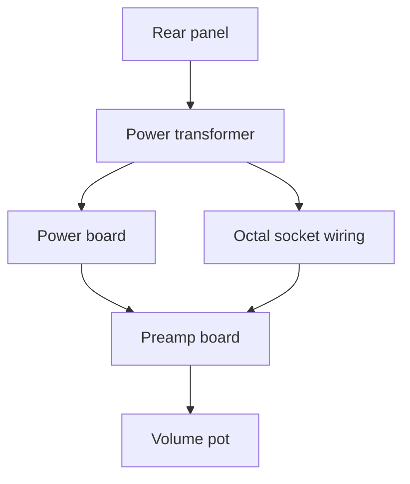

# Hand Schematic Notes

Source: [`photos/hand_schematic.png`](../photos/hand_schematic.png)

Hand-drawn wiring map made during disassembly. Numbered tags were applied when wires were cut. Red-ink entries document additional cuts and color changes at splices.

---

## Layout (top → bottom)

| Region                          | Physical counterpart                                           |
| ------------------------------- | -------------------------------------------------------------- |
| Top strip (LFT / AC / RT / RCA) | Rear panel: speaker terminals, AC inlet, RCA inputs → selector |
| Center block                    | Power transformer                                              |
| V3 / V4 / TP1 detail            | Bias trim pots (underside access: V3, V4, V7, V8)              |
| Horizontal board with caps      | Power board (AC/DC, +B rails)                                  |
| Middle chassis area             | Octal (8-pin) EL34 point-to-point wiring                       |
| Bottom large board              | Preamp board (4× noval sockets + 4× octal holes)               |
| Bottom edge                     | Volume pot (GRN / RED, tag 23)                                 |

---

## Notation conventions

### Wire tags

- A **number** on the drawing = white tag on the physical wire at the cut point.
- Two ends with the same number belong together.
- Tags are disassembly IDs, not factory designators.

### Color labels

- **Single color** (e.g. `BLK`, `BLU`) = current wire insulation color.
- **Two colors** (e.g. `BRN PRP`) = **replacement**, not a twisted pair: wire was **purple**, replaced with **brown**.
- **Red ink** = new splices or re-terminations after additional cuts (see list below).

---

## New splices (red ink, upper left)

| Tag | New color | Path                 | Notes                                                                             |
| --- | --------- | -------------------- | --------------------------------------------------------------------------------- |
| 23  | RED       | **PT** → power board | Was BLK at PT bottom bundle                                                       |
| 21  | RED       | **PT** tap           | Was ORG at PT left tap                                                            |
| 19  | BLU       | **OT** → LFT 8 Ω     | Was BRN (originally PRP→BRN) at speaker path                                      |
| 17  | BLU       | **OT** → RT 4 Ω      | Was YEL at OT secondary (not PT tap)                                              |
| 11  | BRN       | **OT** → RT G        | Was BLK at RT common                                                              |
| 15  | BLK       | **OT** → LFT 4 Ω     | Was BLU at LFT 4 Ω                                                                |
| 13  | RED       | **OT** → RT 8 Ω      | Was BRN (originally PRP→BRN); **separate** from tag 13 RED on PT→power-board path |

Verify each splice with continuity before reassembly.

---

## Rear panel — speaker terminals (**OT** secondaries)

Channel assignment from the top strip of [`hand_schematic.png`](../photos/hand_schematic.png):

| Channel | Tags on OT stubs       |
| ------- | ---------------------- |
| **LFT** | **1**, **15**, **19**  |
| **RT**  | **11**, **17**, **13** |

| Terminal | Tag | Color | Notes                                          |
| -------- | --- | ----- | ---------------------------------------------- |
| LFT 8 Ω  | 19  | BRN   | Was PRP, replaced with brown; new splice → BLU |
| LFT 4 Ω  | 15  | BLU   | New splice → BLK                               |
| LFT G    | 1   | BLK   | Common                                         |
| RT G     | 11  | BLK   | New splice → BRN                               |
| RT 4 Ω   | 17  | BLU   | New splice → BLU (confirm at splice)           |
| RT 8 Ω   | 13  | BRN   | Was PRP, replaced with brown; new splice → RED |

---

## Power transformer harness (**PT** → Power Board / heaters)

| Tag | Color (as drawn) | Destination / notes                                             |
| --- | ---------------- | --------------------------------------------------------------- |
| 23  | BLK → RED        | PT bottom → power board; new splice                             |
| —   | YEL ×2           | Heater (tag 1×2)                                                |
| —   | BRN ×2           | Heater (tag 10×2)                                               |
| —   | WHT ×2           | Heater (tag 5×2)                                                |
| 16  | BLU              | PT secondary                                                    |
| 14  | BLK              | PT secondary                                                    |
| 21  | ORG → RED        | PT tap; new splice                                              |
| 4   | RED              | PT tap                                                          |
| 3   | B                | PT tap (right)                                                  |
| 13  | RED              | PT → power board (red ink, new splice) — **not** RT 8 Ω speaker |
| 15  | B                | PT tap (left) — **not** LFT 4 Ω speaker                         |
| 17  | YEL              | PT tap — **not** RT 4 Ω speaker                                 |

PT label (see `photos/transformers.png`): 260V/300V 300mA, 50V 100mA, 6.3V 3.5A ×2, 115V ×2.

Speaker tags **1, 11, 13, 15, 17, 19** at the rear panel are **OT** secondaries — see section above, not this table.

---

## Power board connections

| Tag            | Color      | Notes                                       |
| -------------- | ---------- | ------------------------------------------- |
| 9              | BLU        | Left bundle in                              |
| 7              | BLK        | Left bundle in                              |
| 23, 21, 19, 17 | GRN bundle | From PT/splice area (red-marked on drawing) |
| 18             | BLK        | Right side                                  |
| 11             | BLK        | Right side                                  |
| 15             | RED        | Right side                                  |
| 6              | BLK        | Right side                                  |
| 16             | BLU        | Right side                                  |

Cross-reference numbered stickers on `photos/desoldered power top.png` and `photos/desoldered power bottom.png`.

Silkscreen rails (OI-3): **+B**, **+B2**, **−B**, **70V IN**; **+B1** on harness tag **21** only.

---

## Bias trim area (V3 / V4 / TP1)

Red-ink tags **19, 21, 17, 23** at octal socket detail — same four **GRN** **C3** wires from Power Board **TP1** (OI-6 closed). Underside bias-trim pots: **V3, V4, V7, V8**.

---

## Chassis — octal (8-pin) EL34 wiring

Four red-circled tags **23, 21, 17, 19** at octal socket positions — **C3** **GRN** from Power Board **TP1** (OI-6). Factory **Vx-TP** = EL34 **pin 8** ([`Jolida-JD202A-int-sch.pdf`](Jolida-JD202A-int-sch.pdf)).

Other labels in this region: 4 RED, 13 RED (crossed out on drawing), 15 RED, 7 YEL, 9 DK BLU, RED 3, BLK 3.

Photos: `photos/8 pin socket.png`, `photos/another 8 pin.png`.

---

## Preamp board (bottom of drawing)

| Location        | Tag | Color         |
| --------------- | --- | ------------- |
| Octal row       | 9   | BLK / DK BLU  |
| Octal row       | 6   | BLK           |
| Noval / OT path | 19  | BRN (was PRP) |
| Noval / OT path | 13  | BRN (was PRP) |
| Internal        | 15  | RED           |
| Internal        | 7   | YEL           |
| Left edge       | 5   | WHT ×2        |
| Volume pot      | 23  | GRN + RED     |

Four large circles = octal (8-pin); four small × circles = noval (9-pin).

**Open question:** Tag 23 appears at PT (BLK/RED), power board (GRN bundle), and volume pot (GRN/RED). Confirm with continuity whether these are one continuous wire or separate cuts sharing a number.

---

## Open items

See [`open-issues.md`](open-issues.md) for schematic cross-check items (grid stoppers, power resistor, 180 µF placement).

Wire-tag / harness items:

- [ ] Resolve tag 23 — single net or multiple wires?
- [ ] Meaning of **13 RED** crossed out on drawing
- [ ] **RED 3 / BLK 3** labels in octal area
- [ ] RCA selector → preamp input wiring (not yet tagged)
- [ ] Map PT colored taps to schematic HV/heater/primary nets

---

## Related docs

- [`schematic-comparison.md`](schematic-comparison.md) — factory PDF vs photos
- [`open-issues.md`](open-issues.md) — OI-1 … OI-5 tracker
- [`wire-tags.md`](wire-tags.md) — tag lookup table
- [`gemini-restoration-notes.md`](gemini-restoration-notes.md) — parts and recap planning
- [`../photos/`](../photos/) — board and chassis photos
