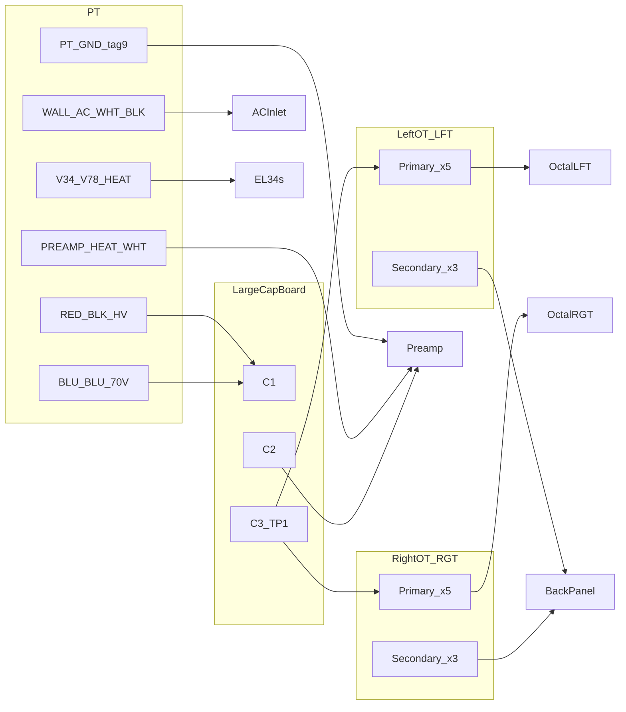

# Wire labels — P-touch 5.8 mm heat shrink

**Unit:** Jolida SJ202A / JD202  
**Tape:** Brother HSe-231 (5.8 mm) or equivalent  
**Rev:** 5 · 2026-07-21 (NFB harness labels **LEFT FEEDBACK** / **RIGHT FEEDBACK** planned)

Print queue for rebuild harness labeling. Tube designators **V1–V8**: [`tubes.md`](tubes.md). **LEFT** / **RIGHT** on OT labels = **LFT** / **RT** channel ([`OT.md`](OT.md)). Identity on stubs still follows **color + tag**, never tag alone — see [`../README.md`](../README.md).

PT harness dress after **18 AWG extensions**: [`PT.md`](PT.md).

---

## Naming rules

| Prefix                                 | Use for                                                             |
| -------------------------------------- | ------------------------------------------------------------------- |
| **WALL AC**                            | Mains **WHT/BLK** (IEC ↔ PT primary splices)                        |
| **PT HV**                              | **RED/BLK** HV twisted pair → Large Cap Board **AC IN**             |
| **70V IN**                             | **BLU/BLU** → Large Cap Board **70V IN** (matches silk)             |
| **PT GND**                             | Tag **9 BLK** → preamp **GND** pour                                 |
| **PREAMP HEAT**                        | **WHT/WHT** → noval heaters (tag **5**)                             |
| **V3/V4 HEAT**                         | **BLK/WHT** (PT coil **BRN/BRN**) → **V3**, **V4** pins **2/7**     |
| **V7/V8 HEAT**                         | **YEL/YEL** → **V7**, **V8** pins **2/7**                           |
| **+B LEFT** / **+B RIGHT**             | **C3** **RED** → LFT / RT OT center tap (tag **13** / **23**)       |
| **Vn PIN 3** / **Vn PIN 4**            | OT primary → EL34 plate / UL ([`OT.md`](OT.md))                     |
| **LEFT COM** / **RIGHT COM**           | OT secondary **BLK** → speaker **G** post (tag **1** / **11**)      |
| **LEFT 4Ω** / **RIGHT 4Ω**             | OT **BLU** → **4 Ω** post (tag **15** / **17**)                     |
| **LEFT 8Ω** / **RIGHT 8Ω**             | OT **BRN** → **8 Ω** post (tag **19** / **13**)                     |
| **LEFT FEEDBACK** / **RIGHT FEEDBACK** | **PRP** (typ.) **8 Ω** post → preamp **LFN** / **RFN** (global NFB) |
| **PWR**                                | Large Cap Board **C2** rails (not OT)                               |
| **TP1**                                | EL34 pin-8 bias sense → Large Cap Board TP1 pads                    |
| **LED±** / **EARTH**                   | Panel LED and IEC safety earth                                      |

**Not in this print batch (still wire):** speaker **G** signal **BLK** (tags **1**, **11**) and **RCA shell** bus → **Large Cap Board GND pour** — see [`back-panel.md`](back-panel.md#signal-ground-at-the-rear-panel).

**Planned labels (speaker NFB):** **LEFT FEEDBACK** / **RIGHT FEEDBACK** on **PRP** runs from **LFT** / **RT** **8 Ω** posts (tags **19** / **13**) to preamp **LFN** / **RFN** — [`preamp-board.md`](preamp-board.md#global-negative-feedback-nfb).

**Color collisions:** **WHT** on **PREAMP HEAT**, on **V3/V4 HEAT** (**BLK/WHT**), and on **LFT/RGT UL B** (OT — different wire). **Labels disambiguate.**

**Applied practice:** one **5.8 mm** sleeve over **both** legs of each twisted pair where it fits ([`PT.md`](PT.md)).

---

## Architecture



---

## PT — applied (2026-07-20)

| Label           | Harness dress     | Coil / tag (verify)           | Destination                 |
| --------------- | ----------------- | ----------------------------- | --------------------------- |
| **WALL AC**     | **WHT** + **BLK** | **RED1+RED2** / **ORG1+ORG2** | IEC ↔ PT primary splices    |
| **PT HV**       | **RED** + **BLK** | tag **21** / **11**           | Large Cap Board **AC IN**   |
| **70V IN**      | **BLU** + **BLU** | tag **17** / **19**           | Large Cap Board **70V IN**  |
| **PT GND**      | **BLK**           | tag **9** (coil **0**)        | Preamp **GND** pour         |
| **PREAMP HEAT** | **WHT** + **WHT** | tag **5**                     | Preamp heater               |
| **V3/V4 HEAT**  | **BLK** + **WHT** | coil **BRN/BRN**              | **V3**, **V4** pins **2/7** |
| **V7/V8 HEAT**  | **YEL** + **YEL** | coil **YEL/YEL**              | **V7**, **V8** pins **2/7** |

Detail: [`PT.md`](PT.md), [`back-panel.md`](back-panel.md) (**WALL AC**).

---

## OT + **C3** +B — applied (2026-07-20)

| Label        | Coil / tag | Wire color | Lands on                                   |
| ------------ | ---------- | ---------- | ------------------------------------------ |
| **+B LEFT**  | **13**     | **RED**    | LFT OT **RED** CT ← Large Cap Board **+B** |
| **+B RIGHT** | **23**     | **RED**    | RT OT **RED** CT ← Large Cap Board **+B**  |

Same **RED** at the large-cap-board end; label at board and/or OT stub.

---

## Left channel OT (LFT) — primaries

Twist **V3 PIN 3** with **V3 PIN 4** (**ORG+YEL**); twist **V4 PIN 3** with **V4 PIN 4** (**BRN+WHT**).

| Label        | Coil | Tube · pin   |
| ------------ | ---- | ------------ |
| **V3 PIN 3** | ORG  | **V3** **3** |
| **V3 PIN 4** | YEL  | **V3** **4** |
| **V4 PIN 3** | BRN  | **V4** **3** |
| **V4 PIN 4** | WHT  | **V4** **4** |

---

## Right channel OT (RT) — primaries

Twist **V7 PIN 3** with **V7 PIN 4**; twist **V8 PIN 3** with **V8 PIN 4**.

| Label        | Coil | Tube · pin   |
| ------------ | ---- | ------------ |
| **V7 PIN 3** | ORG  | **V7** **3** |
| **V7 PIN 4** | YEL  | **V7** **4** |
| **V8 PIN 3** | BRN  | **V8** **3** |
| **V8 PIN 4** | WHT  | **V8** **4** |

---

## Speaker secondaries — applied

| Label         | Coil · tag       | Post        |
| ------------- | ---------------- | ----------- |
| **LEFT COM**  | **BLK** · **1**  | LFT **G**   |
| **LEFT 4Ω**   | **BLU** · **15** | LFT **4 Ω** |
| **LEFT 8Ω**   | **BRN** · **19** | LFT **8 Ω** |
| **RIGHT COM** | **BLK** · **11** | RT **G**    |
| **RIGHT 4Ω**  | **BLU** · **17** | RT **4 Ω**  |
| **RIGHT 8Ω**  | **BRN** · **13** | RT **8 Ω**  |

**LEFT COM** / **RIGHT COM** = OT coil to **G** post only. A **second BLK** at each **G** post → preamp **GND** is not labeled in this batch ([`back-panel.md`](back-panel.md)).

## Other signals

| Label              | Qty  | Wire           | Destination                                    |
| ------------------ | ---- | -------------- | ---------------------------------------------- |
| PWR +B1            | ×1–2 | 15 RED         | Preamp +B1 (C2)                                |
| PWR +B2            | ×1–2 | 7 YEL          | Preamp +B2 (C2)                                |
| PWR −B1            | ×1–2 | 9 BLU          | Preamp −B (C2)                                 |
| PWR GND            | ×1–2 | 6 BLK          | Preamp GND (C2)                                |
| TP1 V3             | ×1–2 | GRN            | V3 pin 8 → TP1 V3 pad                          |
| TP1 V4             | ×1–2 | GRN            | V4 pin 8 → TP1 V4 pad                          |
| TP1 V7             | ×1–2 | GRN            | V7 pin 8 → TP1 V7 pad                          |
| TP1 V8             | ×1–2 | GRN            | V8 pin 8 → TP1 V8 pad                          |
| LED+               | ×1–2 | DK BLU         | Front-panel LED holder                         |
| LED−               | ×1–2 | GRN            | Preamp noval pin (buzz first)                  |
| EARTH              | ×1–2 | GRN/YEL        | IEC earth → chassis star                       |
| **LEFT FEEDBACK**  | ×1   | **PRP** (typ.) | LFT **8 Ω** post (tag **19**) → preamp **LFN** |
| **RIGHT FEEDBACK** | ×1   | **PRP** (typ.) | RT **8 Ω** post (tag **13**) → preamp **RFN**  |

Detail: [`large-cap-board.md`](large-cap-board.md) (C2/C3), [`8-pin-chassis.md`](8-pin-chassis.md) (TP1), [`front-panel.md`](front-panel.md) (LED), [`chassis.md`](chassis.md) (star).

**Optional:** C4 grid wires, C5 volume, C6 RCA — only if labeling 22 AWG Molex runs.

---

## Print summary

| Section     | Unique strings | Applied OT/C3 batch                                            |
| ----------- | -------------- | -------------------------------------------------------------- |
| PT          | 7              | (prior print)                                                  |
| OT + **C3** | 16             | **+B LEFT/RIGHT**, **V3–V8 PIN 3/4**, **LEFT/RIGHT COM/4Ω/8Ω** |
| Other       | 13             | C2, TP1, LED, EARTH, **LEFT/RIGHT FEEDBACK**                   |
| **Total**   | **36**         | + optional ×2 at ends                                          |

**5.8 mm tip:** **+B LEFT** / **+B RIGHT** at large-cap-board **+B** and OT **RED** stub; one sleeve over **V3 PIN 3** + **V3 PIN 4** twisted pair if it fits.

---

## Copy-paste print queue

```text
PT (applied — prior print)
  WALL AC
  PT HV
  70V IN
  PT GND
  PREAMP HEAT
  V3/V4 HEAT
  V7/V8 HEAT

OT + C3 (applied)
  +B LEFT
  +B RIGHT
  V3 PIN 3
  V3 PIN 4
  V4 PIN 3
  V4 PIN 4
  V7 PIN 3
  V7 PIN 4
  V8 PIN 3
  V8 PIN 4
  LEFT COM
  LEFT 4Ω
  LEFT 8Ω
  RIGHT COM
  RIGHT 4Ω
  RIGHT 8Ω

Other signals
  PWR +B1
  PWR +B2
  PWR −B1
  PWR GND
  TP1 V3
  TP1 V4
  TP1 V7
  TP1 V8
  LED+
  LED−
  EARTH
  LEFT FEEDBACK
  RIGHT FEEDBACK
```

---

## Related

- [`PT.md`](PT.md) · [`OT.md`](OT.md) · [`large-cap-board.md`](large-cap-board.md) · [`8-pin-chassis.md`](8-pin-chassis.md)
- [`../archive/wire-tags.md`](../archive/wire-tags.md) — disassembly tag index

## Changelog

| Date       | Change                                                                                                                         |
| ---------- | ------------------------------------------------------------------------------------------------------------------------------ |
| 2026-07-21 | Rev 5 — **LEFT FEEDBACK** / **RIGHT FEEDBACK** on **8 Ω** post → **LFN** / **RFN** **PRP** runs (planned)                      |
| 2026-07-20 | Rev 4 — **applied** OT/C3: **+B LEFT/RIGHT**, **V3–V8 PIN 3/4**, **LEFT/RIGHT COM/4Ω/8Ω**                                      |
| 2026-07-20 | Rev 3 — **applied** PT labels: **WALL AC**, **PT HV**, **70V IN**, **PT GND**, **PREAMP HEAT**, **V3/V4 HEAT**, **V7/V8 HEAT** |
| 2026-07-20 | Rev 2 — PT extension dress (superseded by Rev 3 applied names)                                                                 |
| 2026-07-18 | Rev 1 — initial P-touch queue                                                                                                  |
